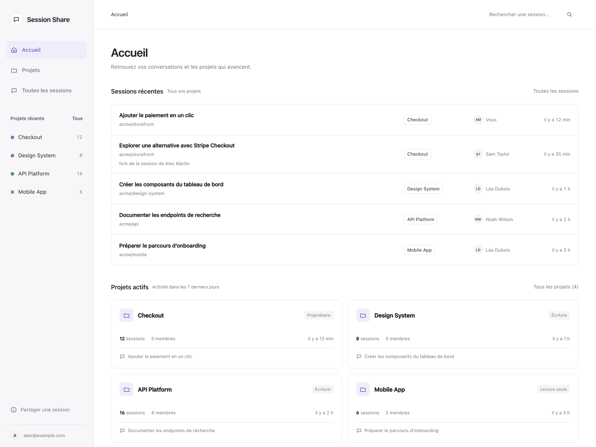

# Share AI Sessions

Share Claude Code and Codex session transcripts with your team: upload, sync, browse by project, and resume a session in either harness. A Cloudflare Worker (R2 + D1) behind Cloudflare Access serves the reader and the API; the `share-session` skill is the client.



*Homepage with fictional sessions, authors, and projects.*

- `src/`: the Worker (reader UI, API, MCP broker for clients without `cloudflared`)
- `skills/share-session/`: the skill and its dependency-free Node 24+ client
- `migrations/`: D1 schema

## Self-host

1. Create the resources: an R2 bucket, a D1 database, a KV namespace (`OAUTH_KV`).
2. In Cloudflare Zero Trust:
   - an Access application on the reader host (e.g. `sessions.example.com`), allowing your team;
   - a Bypass policy on the MCP host (e.g. `sessions-mcp.example.com`); the Worker checks broker tokens itself;
   - an Access SaaS OIDC application for the MCP OAuth flow, with redirect `https://<mcp host>/callback`.
3. Copy `wrangler.toml` into your own deployment and replace every example value (routes, ids, `BROKER_ORIGIN`, `OIDC_CLIENT_ID`, `ACCESS_TEAM_DOMAIN`, `ACCESS_AUD`).
4. Set the secrets: `wrangler secret put BROKER_SIGNING_KEY` (32+ bytes) and `wrangler secret put OIDC_CLIENT_SECRET`.
5. Deploy:

   ```sh
   npm ci
   npx wrangler d1 migrations apply DB --remote
   SESSION_SHARE_BASE_URL=https://sessions.example.com \
   SESSION_SHARE_BROKER_URL=https://sessions-mcp.example.com \
     npm run deploy
   ```

   The two variables bake the server URLs into the `share-session.skill` served from the reader's home page, so it works without setup.

To keep your configuration out of this repository, deploy from a private repository that holds your `wrangler.toml` and pulls this one as a git submodule (point `main`, `migrations_dir` and `assets.directory` into the submodule).

## Develop

```sh
npm ci
npm test        # Worker tests (Miniflare) + client tests
npm run typecheck
```

## License

MIT
